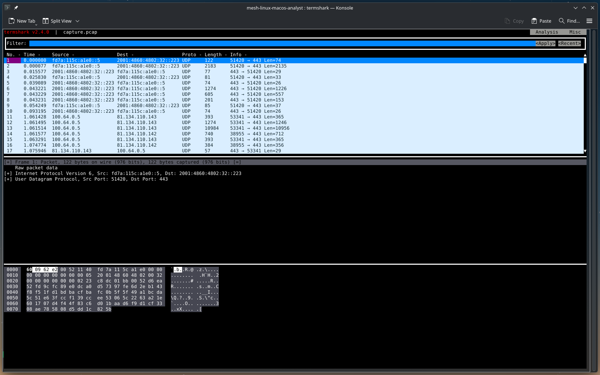

# Packet capture, network monitoring and exit node

Configure the analyst workstation as an exit node to route all endpoint traffic through your workstation, enabling network traffic capture for forensic analysis.

!!! warning "Advanced feature"
    Exit node configuration and packet capture are advanced features that require careful consideration of legal, ethical, and technical implications. Only use these features when legally authorised and technically necessary.

## Overview

### What is an exit node?

An exit node routes all internet traffic from endpoint devices through the analyst workstation, similar to a VPN gateway.

**How it works:**

1. Endpoint device connects to MESH network
2. Endpoint configures analyst workstation as exit node
3. All endpoint internet traffic routes through analyst workstation
4. Analyst can capture and analyse all network traffic

**Use cases:**

- **Network forensics** - Capture and analyse network traffic from suspect devices
- **Malware analysis** - Monitor C2 communications and data exfiltration
- **Evidence collection** - Document network activity for legal proceedings
- **Threat intelligence** - Identify malicious domains and IP addresses
- **Incident response** - Understand attack vectors and lateral movement

## Prerequisites

Before configuring exit node functionality:

1. **Working MESH deployment** - Complete the [Getting started guide](../setup/index.md)
2. **Analyst node** - The containerised analyst from `compose.yml`, with sufficient storage for packet captures
3. **Technical skills** - Familiar with networking and packet analysis

!!! note "No root or sudo required"
    The analyst runs as the unprivileged `mesh` user inside a Docker container
    with `NET_ADMIN`/`NET_RAW` capabilities. Everything on this page runs
    without `sudo`. Host-level `sysctl` changes are **not needed and have no
    effect** on the analyst: IP forwarding is per network namespace, and the
    container's namespace is configured by compose (below).

## Configure analyst node as exit node

### IP forwarding

IP forwarding is enabled inside the analyst's network namespace by the
`sysctls` block on the `analyst` service in `compose.yml`:

```yaml
    sysctls:
      - net.ipv4.ip_forward=1
      - net.ipv6.conf.all.forwarding=1
```

This ships with MESH — there is nothing to run. Do **not** follow generic
Tailscale guides that set `net.ipv4.ip_forward` on the host; the analyst's
namespace does not inherit it.

NAT is also automatic: the MESH daemon installs its own MASQUERADE rule for
exit-node traffic inside the container. No manual `iptables` configuration is
required.

### Advertise exit node to MESH network

Advertising is **opt-in** — the analyst never advertises itself by default.
From your analyst shell (`task analyst`), enable it with a single command:

```bash
mesh set --advertise-exit-node
```

The setting is stored in the analyst's state volume and survives container
restarts and recreates. To stop advertising:

```bash
mesh set --advertise-exit-node=false
```

### Approve the exit node on the control plane

On the control plane, approve the advertised routes:

```bash
# List nodes and their advertised routes
docker compose exec headscale headscale nodes list-routes

# Approve both default routes for the analyst's node ID
docker compose exec headscale headscale nodes approve-routes \
  --identifier <NODE_ID> --routes 0.0.0.0/0,::/0
```

!!! warning "ACLs must allow internet egress"
    If you have configured an ACL policy, tag-to-tag rules alone are not
    enough: endpoints can only use the exit node if the policy also allows
    them to reach the internet, e.g. `"dst": ["tag:<your-net>:*",
    "autogroup:internet:*"]`. A policy without internet egress silently
    drops all exit-node traffic while the nodes still show as online.

### Configure endpoint to use exit node

On the endpoint device (Android), configure it to use the exit node:

**Via MESH Android app:**

1. Open MESH app
2. Go to Settings → Exit node
3. Select your analyst node
4. Enable "Use exit node"

!!! warning "Magic DNS must be off while using an exit node"
    With Magic DNS enabled, DNS queries on the device fail behind an exit
    node (the tailnet has no global upstream resolver), which looks like "no
    internet". Current MESH app builds disable Magic DNS automatically when
    an exit node is selected; on older builds, disable it manually in the
    Settings tab.

**Via meshcli (if available on endpoint):**

```bash
# Use specific exit node
meshcli up --exit-node=<ANALYST_MESH_IP>

# Use any available exit node
meshcli up --exit-node-allow-lan-access
```

## Packet capture (PCAP)

Capture network traffic from endpoint devices for forensic analysis.

### Packet capture tools

**tcpdump** - Command-line packet capture (recommended for continuous capture)
**Wireshark** - GUI packet analyser (recommended for analysis)
**tshark** - Command-line Wireshark (good for scripting)

### Capture tools in the analyst container

`tcpdump` and `suricata` ship in the analyst image, and `tcpdump` carries the
`cap_net_admin`/`cap_net_raw` file capabilities, so the `mesh` user captures
without `sudo`. Write captures to `~/acquisitions` — it is bind-mounted to
`~/mesh-acquisitions` on the host (or `ACQUISITION_DIR` from `.env`), so the
files land outside the container automatically.

All capture commands below run from your analyst shell (`task analyst`).

### Capture all traffic from specific endpoint

Capture on `tailscale0`, where the endpoint's traffic is visible
**decrypted and pre-NAT**, with the endpoint's mesh IP as the source:

```bash
# Get endpoint's mesh IP address
ENDPOINT_IP="100.64.2.1"  # Replace with actual endpoint mesh IP

# Capture all traffic to/from endpoint
tcpdump -i tailscale0 -w ~/acquisitions/endpoint-capture.pcap \
  "host $ENDPOINT_IP"

# Capture with rotation (new file every 100MB, keep 10 files)
tcpdump -i tailscale0 -w ~/acquisitions/endpoint-capture.pcap -C 100 -W 10 \
  "host $ENDPOINT_IP"
```

Capturing on `eth0` instead shows the same traffic post-MASQUERADE (source
rewritten to the container's address), mixed with the analyst's own traffic.

### Capture only exit node traffic

Capture only traffic that's being routed through the exit node (not MESH internal traffic):

```bash
# Get primary network interface
PRIMARY_INTERFACE=$(ip route | grep default | awk '{print $5}')

# Capture only exit node traffic (traffic leaving to internet)
sudo tcpdump -i $PRIMARY_INTERFACE -w exit-node-traffic.pcap \
  "src $ENDPOINT_IP or dst $ENDPOINT_IP"
```

### Capture specific protocols

Capture only specific types of traffic:

```bash
# Capture only HTTP/HTTPS traffic
sudo tcpdump -i any -w http-traffic.pcap \
  "host $ENDPOINT_IP and (port 80 or port 443)"

# Capture only DNS queries
sudo tcpdump -i any -w dns-traffic.pcap \
  "host $ENDPOINT_IP and port 53"

# Capture only TLS/SSL traffic
sudo tcpdump -i any -w tls-traffic.pcap \
  "host $ENDPOINT_IP and tcp port 443"

# Capture only non-encrypted HTTP
sudo tcpdump -i any -w http-plain.pcap \
  "host $ENDPOINT_IP and tcp port 80"
```

### Capture with timestamps and metadata

Add timestamps and metadata for forensic documentation:

```bash
# Create capture directory with timestamp
CAPTURE_DIR="captures/$(date +%Y%m%d_%H%M%S)_endpoint_$ENDPOINT_IP"
mkdir -p "$CAPTURE_DIR"

# Capture with detailed logging
sudo tcpdump -i any -w "$CAPTURE_DIR/capture.pcap" \
  -v -tttt \
  "host $ENDPOINT_IP" \
  2>&1 | tee "$CAPTURE_DIR/capture.log"

# Create metadata file
cat > "$CAPTURE_DIR/metadata.txt" << EOF
Capture Date: $(date)
Endpoint IP: $ENDPOINT_IP
Analyst: $(whoami)
Hostname: $(hostname)
Case Number: [CASE_NUMBER]
Legal Authority: [WARRANT/COURT_ORDER_NUMBER]
Notes: [INVESTIGATION_NOTES]
EOF
```

### Capture filters for forensic investigations

Common capture filters for forensic scenarios:

```bash
# Capture all traffic except MESH internal (only exit node traffic)
sudo tcpdump -i any -w forensic.pcap \
  "host $ENDPOINT_IP and not (dst net 100.64.0.0/10)"

# Capture potential C2 traffic (non-standard ports)
sudo tcpdump -i any -w c2-traffic.pcap \
  "host $ENDPOINT_IP and not (port 80 or port 443 or port 53)"

# Capture potential data exfiltration (large uploads)
sudo tcpdump -i any -w uploads.pcap \
  "host $ENDPOINT_IP and tcp[tcpflags] & tcp-push != 0"

# Capture DNS queries (identify contacted domains)
sudo tcpdump -i any -w dns.pcap -v \
  "host $ENDPOINT_IP and port 53"

# Capture TLS SNI (Server Name Indication) for HTTPS domains
sudo tcpdump -i any -w tls-sni.pcap -v \
  "host $ENDPOINT_IP and tcp port 443"
```

## Analysing captured traffic

## TermShark

We like to do analysis of short term captures via TermShark, this allows you to remate in terminal without having to serve UI's for network analysis.

```bash
termshark -r capture.pcap
```



### Using Wireshark

Open captured traffic in Wireshark:

```bash
# Open capture file
wireshark endpoint-capture.pcap

# Or use tshark for command-line analysis
tshark -r endpoint-capture.pcap
```

### Extract DNS queries

Identify all domains contacted:

```bash
# List all DNS queries
tshark -r endpoint-capture.pcap -Y "dns.qry.name" \
  -T fields -e frame.time -e ip.src -e dns.qry.name

# Get unique domains
tshark -r endpoint-capture.pcap -Y "dns.qry.name" \
  -T fields -e dns.qry.name | sort -u > domains.txt
```

### Extract TLS information

Identify HTTPS domains using SNI:

```bash
# Extract TLS Server Name Indication (SNI)
tshark -r endpoint-capture.pcap -Y "tls.handshake.extensions_server_name" \
  -T fields -e frame.time -e ip.dst -e tls.handshake.extensions_server_name

# Get unique HTTPS domains
tshark -r endpoint-capture.pcap -Y "tls.handshake.extensions_server_name" \
  -T fields -e tls.handshake.extensions_server_name | sort -u > https-domains.txt
```

### Identify suspicious connections

Find connections to suspicious IPs or domains:

```bash
# Check against threat intelligence feeds
# Example: Check if any contacted IPs are in a blocklist
tshark -r endpoint-capture.pcap -T fields -e ip.dst | sort -u > contacted-ips.txt

# Compare with threat intel (example using grep)
grep -Ff contacted-ips.txt /path/to/malicious-ips.txt

# Identify connections to non-standard ports
tshark -r endpoint-capture.pcap -Y "tcp.dstport > 1024 and tcp.dstport != 8080 and tcp.dstport != 8443" \
  -T fields -e frame.time -e ip.dst -e tcp.dstport
```

### Analyse with Suricata IDS

Use Suricata with custom rules to detect malicious activity in captured traffic:

#### Create custom Suricata rules

Create a custom rules file for forensic analysis:

```bash
# Create custom rules directory
sudo mkdir -p /etc/suricata/rules/custom

# Create forensic rules file
sudo tee /etc/suricata/rules/custom/forensic.rules << 'EOF'
# Detect suspicious DNS queries
alert dns any any -> any any (msg:"Suspicious DNS query to known malware domain"; dns.query; content:"malicious-domain.com"; nocase; sid:1000001; rev:1;)

# Detect potential C2 beaconing (regular intervals)
alert tcp any any -> any any (msg:"Potential C2 beacon detected"; flow:established,to_server; threshold:type both, track by_src, count 10, seconds 60; sid:1000002; rev:1;)

EOF
```

#### Configure Suricata for PCAP analysis

Update Suricata configuration:

```bash
# Backup original config
sudo cp /etc/suricata/suricata.yaml /etc/suricata/suricata.yaml.backup

# Add custom rules to configuration
sudo tee -a /etc/suricata/suricata.yaml << 'EOF'

# Custom forensic rules
rule-files:
  - /etc/suricata/rules/custom/forensic.rules
EOF
```

#### Run Suricata against PCAP file

Analyse captured traffic with Suricata:

```bash
# Run Suricata on PCAP file
sudo suricata -r endpoint-capture.pcap -l /var/log/suricata/ -c /etc/suricata/suricata.yaml

# View alerts
cat /var/log/suricata/fast.log

# View detailed alerts in JSON format
jq '.' /var/log/suricata/eve.json | less
```

#### Analyse Suricata output

Extract and analyse Suricata alerts:

```bash
# Count alerts by signature
jq -r 'select(.event_type=="alert") | .alert.signature' /var/log/suricata/eve.json | sort | uniq -c | sort -rn

# Extract all alerts with timestamps
jq -r 'select(.event_type=="alert") | "\(.timestamp) - \(.alert.signature) - \(.src_ip):\(.src_port) -> \(.dest_ip):\(.dest_port)"' /var/log/suricata/eve.json

# Filter high-severity alerts
jq 'select(.event_type=="alert" and .alert.severity <= 2)' /var/log/suricata/eve.json

# Extract DNS queries flagged by Suricata
jq -r 'select(.event_type=="dns") | "\(.timestamp) - \(.dns.rrname) - \(.src_ip)"' /var/log/suricata/eve.json

# Extract HTTP requests flagged by Suricata
jq -r 'select(.event_type=="http") | "\(.timestamp) - \(.http.http_method) \(.http.hostname)\(.http.url) - \(.src_ip)"' /var/log/suricata/eve.json
```

### Timeline analysis

Create timeline of network activity:

```bash
# Generate timeline of all connections
tshark -r endpoint-capture.pcap -T fields \
  -e frame.time -e ip.src -e ip.dst -e tcp.dstport -e udp.dstport \
  > timeline.csv
```

## Security considerations

### Protecting captured data

Captured packet data is highly sensitive and must be protected:

**Encryption:**

```bash
# Encrypt capture files
gpg --symmetric --cipher-algo AES256 endpoint-capture.pcap

# Decrypt when needed
gpg --decrypt endpoint-capture.pcap.gpg > endpoint-capture.pcap
```

**Access control:**

```bash
# Restrict access to capture directory
sudo chmod 700 /var/captures
sudo chown root:root /var/captures

# Only allow specific users
sudo setfacl -m u:analyst:rx /var/captures
```

**Secure storage:**

- Store captures on encrypted filesystem
- Use separate partition with limited space
- Implement automatic deletion after retention period
- Maintain chain of custody documentation

### Privacy considerations

**Minimise data collection:**

- Only capture traffic from authorised devices
- Use specific capture filters to limit scope
- Avoid capturing unrelated traffic
- Delete captures when no longer needed

**Data retention:**

```bash
# Automatic deletion after 90 days
find /var/captures -name "*.pcap" -mtime +90 -delete

# Add to crontab (daily cleanup)
(crontab -l 2>/dev/null; echo "0 3 * * * find /var/captures -name '*.pcap' -mtime +90 -delete") | crontab -
```

## Troubleshooting

### Exit node not working

**Symptoms:**

- Endpoint traffic not routing through analyst workstation
- Public IP check shows endpoint's IP, not analyst's IP

**Solutions:**

1. **Verify IP forwarding inside the container** (not on the host), from
   your analyst shell (`task analyst`):

   ```bash
   cat /proc/sys/net/ipv4/ip_forward /proc/sys/net/ipv6/conf/all/forwarding
   # Should print 1 on both lines
   ```

2. **Check the NAT rule** (analyst shell):

   ```bash
   iptables-save -t nat | grep -i masquerade
   # Should show the ts-postrouting MASQUERADE rule
   ```

3. **Verify advertisement and approval together** (on the control plane):

   ```bash
   docker compose exec headscale headscale nodes list-routes
   # The analyst row should show 0.0.0.0/0 and ::/0 in BOTH the
   # Available and Approved columns.
   ```

   Empty *Available* means the analyst is not advertising — re-run
   `mesh set --advertise-exit-node` in the analyst shell.

4. **Check the ACL policy** allows internet egress
   (`autogroup:internet:*`) and that both nodes carry the tags your rules
   reference (`headscale nodes list` shows tags). An ACL mismatch blocks the
   data path while control traffic and `ping` keep working.

5. **Kick the endpoint's tunnel.** After retagging, policy changes, or an
   analyst recreate, the endpoint may hold a stale netmap: toggle the MESH
   VPN off and on (or Wi-Fi off/on) on the device, then test again. Verify
   data is actually flowing with `tcpdump -i tailscale0 -nn -c 10` in the
   analyst shell — control-plane "online" status and ping replies do not
   prove the data path works.

### Packet capture not capturing traffic

**Symptoms:**

- tcpdump running but no packets captured
- Capture file is empty or very small

**Solutions:**

1. **Verify correct interface:**

   ```bash
   # List all interfaces
   ip link show

   # Capture on all interfaces
   sudo tcpdump -i any -w test.pcap
   ```

2. **Check capture filter:**

   ```bash
   # Test filter syntax
   sudo tcpdump -i any "host $ENDPOINT_IP" -c 10
   ```

3. **Verify endpoint is using exit node:**

   ```bash
   # On endpoint, check routing
   ip route show
   # Should show default route through mesh interface
   ```

4. **Check permissions:**

   ```bash
   # Ensure running as root or with CAP_NET_RAW capability
   sudo tcpdump -i any -w test.pcap
   ```

### High disk usage from captures

**Symptoms:**

- Disk filling up quickly
- System running out of space

**Solutions:**

1. **Use capture rotation:**

   ```bash
   # Limit to 10 files of 100MB each (1GB total)
   sudo tcpdump -i any -w capture.pcap -C 100 -W 10 "host $ENDPOINT_IP"
   ```

2. **Use more specific filters:**

   ```bash
   # Only capture specific protocols
   sudo tcpdump -i any -w capture.pcap "host $ENDPOINT_IP and (port 80 or port 443)"
   ```

3. **Compress old captures:**

   ```bash
   # Compress captures older than 1 day
   find /var/captures -name "*.pcap" -mtime +1 -exec gzip {} \;
   ```

4. **Implement automatic cleanup:**

   ```bash
   # Delete captures older than 30 days
   find /var/captures -name "*.pcap*" -mtime +30 -delete
   ```

## Best practices

### Forensic investigation workflow

**1. Preparation:**

- Obtain legal authorisation
- Document investigation scope
- Prepare capture infrastructure
- Test capture setup

**2. Collection:**

- Start packet capture before connecting endpoint
- Document start time and conditions
- Monitor capture for issues
- Maintain chain of custody

**3. Analysis:**

- Create working copy of captures
- Generate summary reports
- Identify suspicious activity
- Document findings

**4. Preservation:**

- Generate cryptographic hashes
- Store on encrypted media
- Maintain multiple copies
- Document storage location

**5. Reporting:**

- Create forensic report
- Include relevant packet captures
- Document methodology
- Maintain chain of custody

### Performance optimisation

**For high-traffic captures:**

```bash
# Increase kernel buffer size
sudo sysctl -w net.core.rmem_max=134217728
sudo sysctl -w net.core.rmem_default=134217728

# Use larger tcpdump buffer
sudo tcpdump -i any -w capture.pcap -B 65536 "host $ENDPOINT_IP"
```

**For long-term captures:**

- Use SSD for capture storage (faster writes)
- Monitor disk space regularly
- Implement automatic rotation and cleanup
- Use compression for archived captures

### Security hardening

**Restrict access to capture tools:**

```bash
# Only allow specific users to capture
sudo chmod 750 /usr/sbin/tcpdump
sudo chgrp forensics /usr/sbin/tcpdump
```

**Audit capture activity:**

```bash
# Log all tcpdump usage
sudo auditctl -w /usr/sbin/tcpdump -p x -k packet_capture

# View audit logs
sudo ausearch -k packet_capture
```

## Next steps

- **[Control plane advanced](control-plane-advanced.md)** - Advanced control plane configuration
- **[AmneziaWG](amneziawg.md)** - Configure obfuscation for censorship resistance
- **[Troubleshooting](../reference/troubleshooting.md)** - Common issues and solutions

---

← [Back to Advanced](index.md) | [Previous: Control plane advanced](control-plane-advanced.md) →
